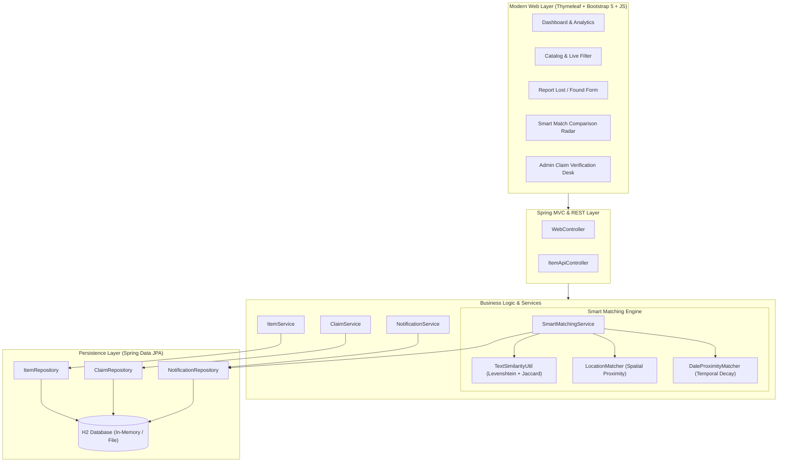

# 🔍 FindIt – Smart Lost & Found Management System

> An intelligent, full-stack Lost & Found management platform built entirely in **Java 17+** and **Spring Boot 3**, powered by an automated multi-factor heuristic matching engine, claim verification workflow, and real-time analytics.

---

## 🌟 Key Highlights & Features

- **🧠 Multi-Factor Smart AI Matching Engine**:
  - Automatically correlates newly reported lost items with turned-in found items in real-time.
  - Combines **Normalized Levenshtein Distance**, **Token-level Jaccard Index** (with custom stop-word filtering), **Spatial Location Proximity**, **Temporal Window Plausibility**, and **Attribute / Brand / Serial Number Alignment**.
  - Assigns confidence ratings:
    - **HIGH MATCH (≥ 75%)**: Automatically dispatches alerts and flags items for reconciliation.
    - **POTENTIAL MATCH (50% – 74%)**: Suggests candidates in the sidebar drawer.
    - **LOW PROBABILITY (< 50%)**: Filtered out to avoid clutter.
- **🛡️ Secure Claim & Handover Workflow**:
  - Claimants submit private proof of ownership (secret marks, contents inside bags, lock screen details, serial numbers).
  - Admins review proofs at the **Claims Desk** and approve or reject with audit notes.
  - On approval, a cryptographically secure **6-digit Handover Verification PIN** is generated. The claimant presents this code at the reception desk for physical release.
- **📊 Real-Time Analytics & Dashboard**:
  - Metric cards for total lost items, found items, recovery rate (%), and pending verifications.
  - Interactive **Chart.js** category distribution donut chart.
  - Instant search and multi-criteria filtering by category, status, type, and keywords.
- **🔔 Notification Alert Feed**:
  - In-app notification center notifying users when smart matches are detected or when claim statuses change.
- **⚡ Zero-Config Embedded Database**:
  - Embedded **H2 Database** with persistence and an active web console at `/h2-console`.
- **🔌 Full REST API**:
  - Clean RESTful endpoints for integration with mobile apps, campus kiosks, or external services.

---

## 🏛️ System Architecture



---

## 📐 Smart Matching Mathematical Formulation

The matching score $S_{\text{total}} \in [0, 1]$ between a Lost Item $L$ and a Found Item $F$ is computed as:

$$S_{\text{total}} = w_{\text{cat}} S_{\text{cat}} + w_{\text{text}} S_{\text{text}} + w_{\text{loc}} S_{\text{loc}} + w_{\text{time}} S_{\text{time}} + w_{\text{attr}} S_{\text{attr}}$$

Where default tuned weights are:
- $w_{\text{cat}} = 0.25$ (Category exact alignment)
- $w_{\text{text}} = 0.35$ (Title & description fuzzy resemblance: $0.65 \times \text{Title} + 0.35 \times \text{Desc}$)
- $w_{\text{loc}} = 0.20$ (Campus building / zone / room proximity)
- $w_{\text{time}} = 0.10$ (Date decay: items found shortly after lost date receive maximum score)
- $w_{\text{attr}} = 0.10$ (Brand, model, color, and unique serial match)

If $S_{\text{cat}} = 1.0$ and title similarity $> 0.80$, a **synergy boost** of $+0.08$ is added.

---

## 📂 Project Directory Structure

```text
findit-lost-and-found/
├── pom.xml                                    # Maven dependencies & build setup
├── run.bat                                    # One-click Windows CMD launcher
├── run.ps1                                    # One-click PowerShell launcher
├── mvnw.cmd                                   # Maven wrapper batch file
├── README.md                                  # Complete documentation
├── .mvn/wrapper/
│   └── maven-wrapper.properties
└── src/
    ├── main/
    │   ├── java/com/findit/
    │   │   ├── FindItApplication.java         # Spring Boot entry point
    │   │   ├── config/
    │   │   │   └── DataSeeder.java            # Seeds realistic demo items & claims
    │   │   ├── model/
    │   │   │   ├── Item.java                  # JPA Entity: Lost & Found items
    │   │   │   ├── ItemCategory.java          # Enum: Categories with icons & colors
    │   │   │   ├── ItemType.java              # Enum: LOST, FOUND
    │   │   │   ├── ItemStatus.java            # Enum: OPEN, UNDER_REVIEW, MATCHED, CLAIMED
    │   │   │   ├── Claim.java                 # JPA Entity: Ownership claims
    │   │   │   ├── ClaimStatus.java           # Enum: PENDING, APPROVED, REJECTED, COMPLETED
    │   │   │   ├── Notification.java          # JPA Entity: In-app notifications
    │   │   │   └── MatchResult.java           # DTO: Algorithm breakdown scores
    │   │   ├── repository/
    │   │   │   ├── ItemRepository.java        # Custom JPA query methods
    │   │   │   ├── ClaimRepository.java
    │   │   │   └── NotificationRepository.java
    │   │   ├── service/
    │   │   │   ├── ItemService.java           # Item CRUD & stats
    │   │   │   ├── ClaimService.java          # Claim workflow & 6-digit PIN generator
    │   │   │   ├── NotificationService.java   # Notification alerts
    │   │   │   └── matching/
    │   │   │       ├── SmartMatchingService.java   # Algorithm coordinator
    │   │   │       ├── TextSimilarityUtil.java     # Levenshtein + Jaccard tokens
    │   │   │       ├── LocationMatcher.java        # Spatial similarity
    │   │   │       └── DateProximityMatcher.java   # Temporal plausibility
    │   │   └── controller/
    │   │       ├── WebController.java         # MVC controller for Thymeleaf pages
    │   │       └── ItemApiController.java     # RESTful JSON endpoints
    │   └── resources/
    │       ├── application.properties         # Server & DB configurations
    │       ├── static/
    │       │   ├── css/custom.css             # Glassmorphic dark styling
    │       │   └── js/app.js                  # Dynamic Chart.js & UI interactions
    │       └── templates/
    │           ├── layout/base.html           # Master navigation & footer layout
    │           ├── index.html                 # Main Dashboard & Analytics
    │           ├── notifications.html         # Alerts center
    │           ├── items/
    │           │   ├── list.html              # Searchable item catalog
    │           │   ├── report.html            # Report Lost / Found form
    │           │   ├── detail.html            # Item details & claim modal
    │           │   └── match.html             # Smart Match deep dive comparison
    │           └── claims/
    │               └── list.html              # Staff claims desk & PIN verification
    └── test/
        └── java/com/findit/
            ├── TextSimilarityUtilTest.java    # Algorithm unit tests
            └── SmartMatchingServiceTest.java  # Heuristic scoring tests
```

---

## 🚀 How to Run the Project

### Prerequisites
- **Java Development Kit (JDK) 17 or higher** installed.
  - If you do not have Java installed, download OpenJDK 17 or 21 from [Adoptium Eclipse Temurin](https://adoptium.net/).
  - Ensure `JAVA_HOME` is set or `java` is in your environment PATH.

### Method 1: One-Click Run (Windows)
Double-click `run.bat` or open PowerShell inside the project directory and run:
```powershell
.\run.ps1
```

### Method 2: Command Line via Maven
If Maven is installed on your computer:
```bash
mvn clean spring-boot:run
```

### Method 3: In Your Favorite Java IDE
1. Open **IntelliJ IDEA**, **Eclipse**, or **VS Code**.
2. Select **Open Project** and pick the `findit-lost-and-found` folder.
3. Allow the IDE to import Maven dependencies from `pom.xml`.
4. Locate `src/main/java/com/findit/FindItApplication.java`.
5. Right-click and select **Run 'FindItApplication'**.

---

## 🌐 URLs & Access Points

Once started, open your web browser:

| Portal | URL | Description |
|---|---|---|
| **Web Application** | `http://localhost:8080` | Main User & Admin Dashboard |
| **Browse Items** | `http://localhost:8080/items` | Filterable lost & found inventory |
| **Report an Item** | `http://localhost:8080/items/report` | Interactive submission form |
| **Claims Desk** | `http://localhost:8080/claims` | Staff verification & pickup PIN portal |
| **H2 Web Console** | `http://localhost:8080/h2-console` | JDBC URL: `jdbc:h2:mem:finditdb`, User: `sa`, Password: *(empty)* |
| **REST API** | `http://localhost:8080/api/items` | JSON endpoints for external integration |

---

## 🧪 Pre-Seeded Test Scenarios (Ready to Test!)

When launched, `DataSeeder.java` automatically initializes realistic campus scenarios:

1. **MacBook Pro 14" High Match**:
   - **Lost Item #1**: Space Gray Apple MacBook Pro reported lost at Science Block 3rd Floor Library.
   - **Found Item #2**: Space Gray MacBook Pro turned in at Science Block Quiet Study Area.
   - 🎯 **Test it**: Click on Item #1 or #2 and view the **Smart Match Radar**! The algorithm scores it with **~88% High Match** confidence!
2. **Brown Fossil Wallet Claim Verification**:
   - **Found Item #4**: Fossil Brown Wallet found at Student Cafeteria.
   - **Claim**: User *David Lee* submitted a claim with student ID proof.
   - 🎯 **Test it**: Navigate to **Claims Desk** (`/claims`). Review David's proof, click **Approve**, note the **Handover PIN** generated, and test PIN verification!
3. **Headphones & Keys**:
   - Try reporting a new item (e.g. "Sony Wireless Headphones" or "Car Keys") and watch the real-time matching engine in action!

---

## 📡 REST API Reference

| Method | Endpoint | Description |
|---|---|---|
| `GET` | `/api/items` | Query items with optional `type`, `category`, `status`, and `keyword` |
| `GET` | `/api/items/{id}` | Get item details by ID |
| `POST` | `/api/items` | Create a new lost or found item |
| `DELETE` | `/api/items/{id}` | Remove an item |
| `GET` | `/api/items/{id}/matches` | Returns ranked smart matches with vector scores & reasons |
| `POST` | `/api/claims` | Submit an ownership verification claim |
| `GET` | `/api/stats` | System statistics (recovery rate, counts by category) |

---

## 🛡️ License

This project is created for educational, portfolio, and enterprise lost-and-found management deployments.
Built with ❤️ in 100% pure Java.
"# findit-smart-lost-and-found" 
